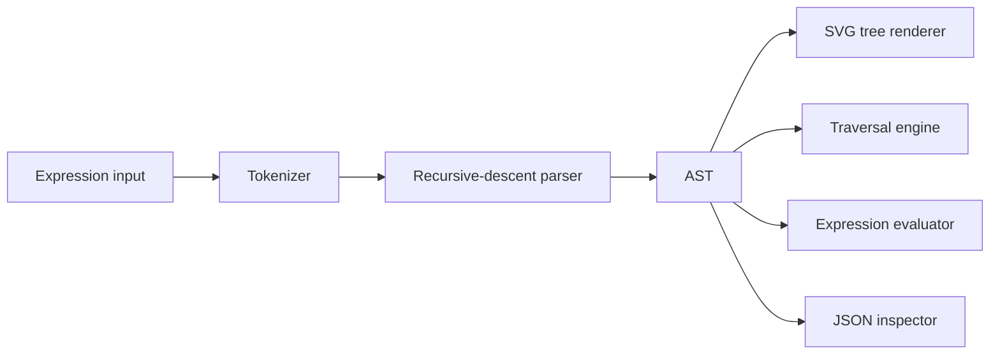

[README.md](https://github.com/user-attachments/files/34029602/README.md)
# ParseVision

**An interactive Abstract Syntax Tree (AST) generator, visualizer, and expression evaluator.**

ParseVision is a browser-based workspace for exploring arithmetic expressions and core compiler concepts. Enter an expression to tokenize and parse it into a structured AST, inspect its hierarchy on an interactive canvas, step through traversal algorithms, and evaluate supported numerical expressions.

Built with JavaScript, SVG, HTML, CSS, and Vite, ParseVision runs its core parsing, evaluation, and visualization workflows in the browser without requiring a backend or database.

<!-- Add a genuine screenshot of the current application when one is available. -->
<!--  -->

## Highlights

- **Expression parsing:** Recursive-descent parsing for arithmetic expressions, numeric literals, identifiers, and parentheses.
- **Operator precedence:** Represents unary, multiplicative, and additive operations correctly in the AST.
- **Interactive AST canvas:** Explore a hierarchical tree with SVG connectors, semantic node colors, zoom, and pan.
- **Traversal playback:** Step through preorder, inorder, and postorder traversal with playback controls and adjustable speed.
- **Node inspection:** Inspect node properties and view the AST as formatted JSON.
- **Expression evaluation:** Compute supported numerical expressions.
- **Error diagnostics:** Surface lexical and syntax errors with character offsets.
- **PNG export:** Export the AST visualization as an image.
- **Responsive interface:** Use the application across desktop, tablet, and mobile layouts.

## From Expression to AST

Consider the expression:

```text
2 + 3 * (4 - 1)
```

Multiplication has higher precedence than addition, so the root `+` node has `2` as its left child and the multiplication subtree as its right child. The parenthesized subtraction becomes the right child of `*`.


The expression evaluates to **`11`**:

1. Evaluate the parenthesized expression: `4 - 1 = 3`.
2. Multiply: `3 * 3 = 9`.
3. Add: `2 + 9 = 11`.

### Traversal orders

For this AST, the traversal sequences are:

| Traversal | Visit order |
|---|---|
| **Preorder** (node, left, right) | `+` → `2` → `*` → `3` → `-` → `4` → `1` |
| **Inorder** (left, node, right) | `2` → `+` → `3` → `*` → `4` → `-` → `1` |
| **Postorder** (left, right, node) | `2` → `3` → `4` → `1` → `-` → `*` → `+` |

### Example AST JSON

The following illustrates the nested object structure for this expression. Confirm node names and fields against the current parser implementation before relying on this as a serialized contract.

```json
{
  "type": "BinaryExpression",
  "operator": "+",
  "left": {
    "type": "Literal",
    "value": 2,
    "raw": "2"
  },
  "right": {
    "type": "BinaryExpression",
    "operator": "*",
    "left": {
      "type": "Literal",
      "value": 3,
      "raw": "3"
    },
    "right": {
      "type": "BinaryExpression",
      "operator": "-",
      "left": {
        "type": "Literal",
        "value": 4,
        "raw": "4"
      },
      "right": {
        "type": "Literal",
        "value": 1,
        "raw": "1"
      }
    }
  }
}
```

## Supported Syntax

ParseVision focuses on arithmetic expression parsing rather than a complete programming language.

### Grammar

The parser uses a non-left-recursive grammar:

```text
E  → T E'
E' → + T E' | - T E' | ε
T  → U T'
T' → * U T' | / U T' | ε
U  → + U | - U | P
P  → ( E ) | id | num
```

### Supported constructs

| Construct | Example | Notes |
|---|---|---|
| Addition | `a + b` | Binary, left-associative |
| Subtraction | `a - b` | Binary, left-associative |
| Multiplication | `a * b` | Binary, left-associative |
| Division | `a / b` | Binary, left-associative |
| Unary plus | `+a` | Prefix operator |
| Unary minus | `-a` | Prefix operator |
| Parentheses | `(a + b) * c` | Explicit grouping |
| Numeric literals | `42`, `3.14`, `.5`, `5.` | Confirm exact accepted forms in the tokenizer |
| Identifiers | `x`, `total`, `count_1` | Names beginning with a letter or underscore |

### Operator precedence

| Precedence | Operators / constructs | Associativity |
|---|---|---|
| Highest | Parenthesized expressions, literals, identifiers | — |
| 3 | Unary `+`, unary `-` | Prefix / right-recursive |
| 2 | `*`, `/` | Left to right |
| Lowest | Binary `+`, binary `-` | Left to right |

### Unsupported syntax

The documented grammar does not include modulo (`%`), exponentiation (`**` or `^`), assignment, comparisons, bitwise operators, statements, or control-flow constructs.

ParseVision is an arithmetic-expression explorer, not a general-purpose JavaScript parser or interpreter.

## AST Node Model

The AST uses plain JavaScript objects to represent syntax. The node names and fields below should match the current implementation.

| Node type | Purpose | Typical properties |
|---|---|---|
| `BinaryExpression` | An operation with two operands | `type`, `operator`, `left`, `right` |
| `UnaryExpression` | A prefix operation with one operand | `type`, `operator`, `argument` |
| `Identifier` | A variable or symbol name | `type`, `name` |
| `Literal` | A numeric literal | `type`, `value`, `raw` |

### Visual node categories

The canvas uses color to distinguish semantic roles:

| Category | Color | Hex |
|---|---|---|
| Root node | Red | `#EF4444` |
| Binary expression | Blue | `#3B82F6` |
| Unary expression | Orange | `#F97316` |
| Identifier | Green | `#22C55E` |
| Numeric literal | Yellow | `#FACC15` |

## How It Works

ParseVision separates syntax analysis from visualization and interaction.



1. **Tokenization** — scans the source expression and identifies numbers, identifiers, operators, and parentheses while tracking character offsets.
2. **Parsing** — consumes tokens according to the arithmetic grammar, enforcing precedence and grouping.
3. **AST construction** — represents the expression as a hierarchy of typed nodes.
4. **Tree layout and rendering** — calculates node positions and draws the hierarchy with SVG connectors and node cards.
5. **Traversal and evaluation** — operates on the AST independently of its visual representation.
6. **Inspection and diagnostics** — lets users inspect the structure and understand invalid input.

## Interacting with the Canvas

### Viewport navigation

- **Pan:** Drag on the canvas to move around the tree.
- **Zoom:** Use the `+` and `−` controls or `Ctrl`/`Cmd` while scrolling, where supported.
- **Reset zoom:** Use the `100%` control.
- **Fit to view:** Use the fit shortcut if available in the current build.

### Traversal playback

Choose preorder, inorder, or postorder to view the corresponding visit sequence. Playback controls allow the traversal to be played, paused, or replayed, with configurable speeds.

### Inspecting nodes

Select a node to highlight it and inspect its semantic information. The AST inspector presents the serialized tree as formatted JSON and supports copying the JSON payload.

### Export

Export the current AST diagram as a PNG image.

> Interaction details and keyboard shortcuts should be checked against the current implementation before being documented as guaranteed behavior.

## Technology Stack

| Technology | Role |
|---|---|
| JavaScript (ES modules) | Tokenization, parsing, AST construction, evaluation, and interaction |
| HTML5 and CSS | Application structure, layout, and responsive styling |
| SVG | AST nodes, connectors, and scalable tree visualization |
| Vite | Local development server and production bundler |

ParseVision uses browser-side computation. It does not require a backend service or database for its core parsing, visualization, and evaluation workflows.

## Getting Started

### Prerequisites

- [Node.js](https://nodejs.org/)
- npm, included with Node.js

Use a Node.js version supported by the Vite version specified in `package.json`.

### Install

```bash
git clone <YOUR_REPOSITORY_URL>
cd ParseVision
npm ci
```

Replace `<YOUR_REPOSITORY_URL>` with the repository's actual Git URL.

### Run locally

```bash
npm run dev
```

Open the local URL printed by Vite in your browser.

### Build for production

```bash
npm run build
```

Vite writes the production build to `dist/`.

## Project Structure

```text
ParseVision/
├── index.html
├── package.json
├── vite.config.js
└── src/
    ├── main.js
    ├── parser/
    │   ├── grammar.js
    │   ├── tokenizer.js
    │   ├── ast.js
    │   ├── parser.js
    │   └── evaluator.js
    ├── traversal/
    │   └── traversal.js
    ├── visualizer/
    │   ├── nodeStyles.js
    │   └── treeRenderer.js
    ├── components/
    │   ├── editor.js
    │   ├── outputPanel.js
    │   ├── inspectAstPanel.js
    │   └── toast.js
    └── styles/
        └── style.css
```

- `main.js` — application entry point and event orchestration.
- `parser/` — grammar, tokenization, AST construction, parsing, and evaluation.
- `traversal/` — tree traversal algorithms.
- `visualizer/` — node styles, tree layout, SVG rendering, and export.
- `components/` — expression editor, output canvas, AST inspector, and notifications.
- `styles/` — application styling and responsive layout.

## Scope and Limitations

- **Arithmetic grammar:** The parser handles the expression forms listed above; it does not parse complete programs, declarations, functions, or control flow.
- **Identifiers:** Identifiers can be represented in the AST. Evaluating expressions that contain identifiers requires variable bindings supported by the evaluator interface.
- **Division by zero:** Division by zero is syntactically valid; the numeric result follows JavaScript number semantics.
- **Browser-side execution:** Core parsing, evaluation, and rendering run locally in the browser.

## Potential Extensions

Possible future directions include:

- An interactive variable environment for evaluating identifier-based expressions.
- Step-by-step visualization of expression evaluation.
- Additional operators and grammar rules.
- Breadth-first (level-order) traversal.
- An interactive grammar explorer.

These are potential enhancements, not claims about existing functionality.

## License

Check the repository for a `LICENSE` file before redistributing or reusing this project. If no license is present, the repository does not currently specify an open-source license.
