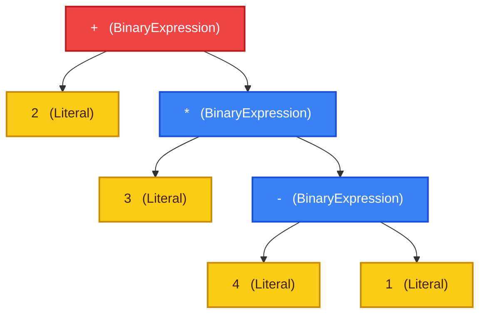
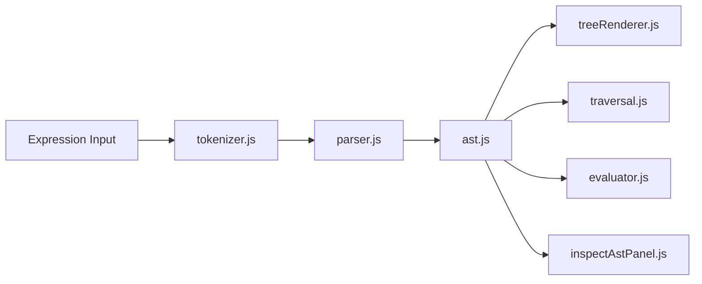

# ParseVision

> An interactive Abstract Syntax Tree generator, visualizer, and expression evaluator — built entirely in the browser with zero runtime dependencies.

ParseVision is an educational developer tool for exploring compiler frontend fundamentals. It accepts arithmetic, algebraic, assignment, modulo, and exponentiation expressions, parses them through a deterministic recursive-descent parser, and renders the resulting Abstract Syntax Tree (AST) on an interactive SVG canvas with strict mathematical symmetry.

---

## Quick Start

**Prerequisites:** [Node.js](https://nodejs.org/) v20.19+ or v22.12+ (LTS) with `npm`.

```bash
git clone https://github.com/Apurba-0001/ParseVision
cd ParseVision
npm install
npm run dev
```

Open `http://127.0.0.1:5173/` in any modern browser.

```bash
# Production build
npm run build          # outputs to dist/

# Preview production build locally
npx vite preview
```

---

## Features

### Parsing & Grammar
- **Recursive-Descent Parser** — LL(1), deterministic, non-left-recursive
- **6-Level Operator Precedence** — assignment → additive → multiplicative/modulo → exponentiation → unary → primary
- **Right-Associative Exponentiation** — `**` and `^` both supported (`2 ** 3 ** 2 === 512`)
- **Variable Assignment** — first-class `AssignmentExpression` nodes; chained assignment (`a = b = 5`)
- **Prefix Unary Operators** — `+x`, `-x` with correct algebraic binding (`-2 ** 2 === -4`)
- **Parenthesized Grouping** — explicit precedence override via `( ... )`

### AST Visualization
- **Interactive SVG Canvas** — hierarchical tree layout with cubic bezier connector curves
- **Strict Parent-Child Symmetry** — every binary parent is at the exact midpoint of its children
- **Root-Anchored Viewport** — root node always centered at `viewportWidth / 2` on render and resize
- **Collision-Free Layout** — recursively computed subtree bounding widths; uniform 64×64 px nodes
- **Semantic Color Coding** — distinct colors per node type (see [Node Color Tokens](#node-color-tokens))
- **Node Inspection** — click any node for a toast showing its type and properties

### Traversal Playback
- **Three Algorithms** — Preorder, Inorder, Postorder depth-first traversals
- **Animated Playback** — Play / Pause / Replay controls with sequential visit badges
- **Configurable Speed** — `1×` (800 ms/step), `1.5×` (533 ms), `2×` (400 ms)

### Evaluation & Diagnostics
- **IEEE 754 Arithmetic** — standard floating-point; division by zero yields `Infinity`
- **Session Variable Storage** — assignments persist across evaluations; cleared by **Clear**
- **Targeted Error Reporting** — zero-based character-offset diagnostics (e.g., `at character 7`)
- **Canonical Presets** — built-in expressions demonstrating each language feature

### Navigation & Export
- **Pan & Zoom** — drag to pan; `Ctrl + Wheel` or toolbar `+` / `-` to zoom; `F` to fit
- **AST JSON Inspector** — formatted, syntax-highlighted JSON modal with node count and byte size
- **PNG Export** — one-click high-resolution rasterization as `parsevision-ast.png`
- **Responsive Layout** — scales from 320 px mobile to 1920 px+ ultra-wide

---

## Keyboard Shortcuts

| Shortcut | Action |
|---|---|
| `Ctrl + Enter` | Parse expression and generate AST |
| `Escape` | Close AST Inspector modal |
| `+` / `=` | Zoom in |
| `-` | Zoom out |
| `0` | Reset zoom to 100% |
| `F` | Fit tree to viewport |
| `↑ ↓ ← →` | Pan canvas (50 px per step) |
| `← →` *(traversal group)* | Switch traversal algorithm |

---

## Supported Syntax

### Formal Grammar

```
A  → id = A | E
E  → T E'
E' → + T E' | - T E' | ε
T  → U T'
T' → * U T' | / U T' | % U T' | ε
U  → + U | - U | X
X  → P ** U | P ^ U | P
P  → ( A ) | id | num
```

### Operator Precedence

| Level | Operator | Associativity |
|---|---|---|
| 6 (highest) | `( )`, `id`, `num` | — |
| 5 | `+x`, `-x` (unary) | Right-to-Left |
| 4 | `**`, `^` | Right-to-Left |
| 3 | `*`, `/`, `%` | Left-to-Right |
| 2 | `+`, `-` | Left-to-Right |
| 1 (lowest) | `=` | Right-to-Left |

### Unsupported Constructs

The following are outside the grammar and produce targeted diagnostics:

- Comparison operators: `==`, `!=`, `<`, `>`, `<=`, `>=`
- Logical / bitwise operators: `&&`, `||`, `!`, `&`, `|`, `~`
- Control flow: `if`, `while`, `for`, function declarations, semicolons

---

## Example: `2 + 3 * (4 - 1)`



**Evaluation:** `2 + (3 * (4 - 1))` = `2 + 9` = **`11`**

**Traversal sequences:**

| Algorithm | Visit Order |
|---|---|
| **Preorder** | `+` → `2` → `*` → `3` → `-` → `4` → `1` |
| **Inorder** | `2` → `+` → `3` → `*` → `4` → `-` → `1` |
| **Postorder** | `2` → `3` → `4` → `1` → `-` → `*` → `+` |

---

## AST Node Types

The parser emits five plain JavaScript object node types with no circular references or DOM coupling.

| Node Type | Key Fields | Represents |
|---|---|---|
| `AssignmentExpression` | `operator`, `left` (Identifier), `right` | Variable assignment (`x = 5`) |
| `BinaryExpression` | `operator`, `left`, `right` | Infix operations (`+`, `-`, `*`, `/`, `%`, `**`, `^`) |
| `UnaryExpression` | `operator`, `argument` | Prefix sign (`+x`, `-x`) |
| `Identifier` | `name` | Variable or symbol name |
| `Literal` | `value` (number), `raw` (string) | Numeric constant |

> **UI note:** `Literal` nodes are displayed as **`NumericLiteral`** in the canvas legend and toast inspector to make their role immediately clear. The evaluator and renderer accept both labels interchangeably.

### Node Color Tokens

| Node Type | UI Label | Color |
|---|---|---|
| Root entry point | `Root Node` | `#EF4444` (red) |
| `AssignmentExpression` | `AssignmentExpression` | `#8B5CF6` (violet) |
| `BinaryExpression` | `BinaryExpression` | `#3B82F6` (blue) |
| `UnaryExpression` | `UnaryExpression` | `#F97316` (orange) |
| `Identifier` | `Identifier` | `#22C55E` (green) |
| `Literal` | `NumericLiteral` | `#FACC15` (yellow) |

---

## Architecture

ParseVision cleanly separates lexical analysis, parsing, evaluation, and rendering into discrete modules.



### Module Responsibilities

| File | Responsibility |
|---|---|
| `grammar.js` | Formal grammar definition, operator sets, precedence tables |
| `tokenizer.js` | Lexical analysis; emits `NUMBER`, `IDENTIFIER`, `OPERATOR`, `PAREN`, `ASSIGN`, `EOF` tokens with character offsets |
| `parser.js` | Recursive-descent parser; builds plain-object ASTs via `parseAssignment` → `parseAdditive` → `parseTerm` → `parseUnary` → `parsePrimary` |
| `ast.js` | Node factory functions with structural validation |
| `evaluator.js` | IEEE 754 arithmetic evaluation with session-scoped variable environment |
| `traversal.js` | Pure preorder, inorder, and postorder traversal functions |
| `treeRenderer.js` | Layout engine, SVG bezier curves, viewport anchoring, PNG export |
| `nodeStyles.js` | Color tokens, dimensions, legend config |
| `editor.js` | Expression input, presets, diagnostic status bar |
| `outputPanel.js` | Canvas, pan/zoom engine, playback controls |
| `inspectAstPanel.js` | AST JSON modal with syntax highlighting |
| `toast.js` | Floating notification utility |

---

## Project Structure

```
ParseVision/
├── index.html                 # HTML shell and application mount point
├── package.json               # Project metadata and build scripts
├── vite.config.js             # Vite configuration
└── src/
    ├── main.js                # Entry point and component orchestration
    ├── parser/
    │   ├── grammar.js
    │   ├── tokenizer.js
    │   ├── ast.js
    │   ├── parser.js
    │   └── evaluator.js
    ├── traversal/
    │   └── traversal.js
    ├── visualizer/
    │   ├── nodeStyles.js
    │   └── treeRenderer.js
    ├── components/
    │   ├── editor.js
    │   ├── outputPanel.js
    │   ├── inspectAstPanel.js
    │   └── toast.js
    └── styles/
        └── style.css
```

---

## Technology Stack

| Concern | Choice |
|---|---|
| Language | JavaScript (ES modules, `"type": "module"`) |
| Rendering | SVG (cubic bezier curves, coordinate layout) |
| Markup & Styling | Semantic HTML5, CSS3, custom design tokens |
| Typography & Icons | Google Fonts (*Inter*, *JetBrains Mono*), Material Symbols |
| Build Tool | [Vite 7](https://vite.dev/) (sole dev dependency) |
| Runtime Dependencies | **None** |

---

## Scope & Limitations

- **Expression-level only** — no statement blocks, conditionals, loops, or function declarations
- **Session environment** — variable assignments persist in-memory per session; cleared by **Clear**
- **Division by zero** — yields `Infinity` / `-Infinity` per IEEE 754; modulo by zero throws a runtime error
- **Client-side only** — no data is transmitted externally; everything runs in the browser

---

## License

This project does not currently specify an open-source license. All rights are reserved by the author.
